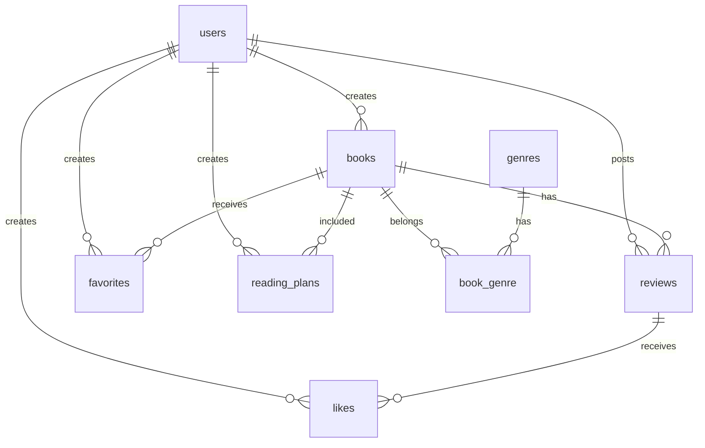

# Bookshelf 書籍レビューアプリ

## 概要

書籍管理アプリです。

ユーザーは書籍の登録・編集・削除、レビュー投稿、お気に入り登録などを行えます。
また、API機能として書籍情報の取得・登録・更新・削除を提供しています。

## 使用技術

- PHP 8.5.9
- Laravel 10
- MySQL 8.4.11
- Docker
- Laravel Sail
- Laravel Sanctum

## ER図



## 環境構築

### リポジトリを取得

```bash
git clone https://github.com/kanon-non-mad/bookshelf-app.git
cd bookshelf-app
```

## 起動方法

```bash
composer install
cp .env.example .env
./vendor/bin/sail up -d
./vendor/bin/sail artisan key:generate
./vendor/bin/sail artisan migrate --seed
./vendor/bin/sail artisan storage:link
```

## テスト

```bash
./vendor/bin/sail artisan test
```

## 主な機能

- ユーザー認証
- 書籍CRUD
- レビュー投稿
- お気に入り登録
- いいね機能
- ジャンル管理
- 読書計画管理
    - 読書予定の登録
    - 読書予定日の編集
    - 読書完了状態への変更
    - 読書計画の削除

## API仕様

書き込み系APIでは Laravel Sanctum の Bearer Token認証を使用しています。

### 認証

書き込み系APIでは Laravel Sanctum を使用した Bearer Token認証を採用しています。

ログインAPIで取得したtokenを使用します。

リクエストヘッダー:

Authorization: Bearer {token}

### 認証API

| Method | URL                | 認証 | 概要                         |
| ------ | ------------------ | ---- | ---------------------------- |
| POST   | /api/v1/auth/login | 不要 | ログインしてBearer Token取得 |

### 書籍API

| Method | URL                | 認証 | 概要         |
| ------ | ------------------ | ---- | ------------ |
| GET    | /api/v1/books      | 不要 | 書籍一覧取得 |
| GET    | /api/v1/books/{id} | 不要 | 書籍詳細取得 |
| POST   | /api/v1/books      | 必要 | 書籍登録     |
| PATCH  | /api/v1/books/{id} | 必要 | 書籍更新     |
| DELETE | /api/v1/books/{id} | 必要 | 書籍削除     |

### APIクエリパラメータ

| Parameter | 説明               |
| --------- | ------------------ |
| keyword   | タイトル・著者検索 |
| genre_id  | ジャンル検索       |

## テスト結果

全テスト成功済み

```bash
./vendor/bin/sail artisan test
95 passed (218 assertions)
```

## 開発環境URL

http://localhost

## 作成者

kanon-non-mad
