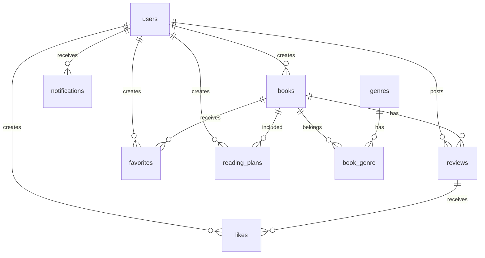

# Bookshelf 書籍レビューアプリ

## 概要

書籍管理アプリです。

ユーザーは書籍の登録・編集・削除、レビュー投稿、お気に入り登録、読書計画の管理などを行えます。
また、API機能として書籍CRUD APIを提供しています。
ISBN検索機能ではGoogle Books APIを利用して書籍情報を取得できます。
書籍一覧APIでは検索、ページネーション、並び替え、レビュー情報・ジャンル情報・評価情報の取得にも対応しています。

## 使用技術

- PHP 8.5.9
- Laravel 10
- MySQL 8.4.11
- Docker
- Laravel Sail
- Laravel Sanctum
- Vite
- Tailwind CSS

## 開発ルール

Laravel Pintを使用してコード整形を行っています。

確認コマンド:

```bash
./vendor/bin/sail pint --test
```

## ER図


**## 環境構築**

### Google Books API設定

ISBN検索機能ではGoogle Books APIを使用しています。

`.env` に以下を設定してください。

```env
GOOGLE_BOOKS_API_URL=https://www.googleapis.com/books/v1/volumes
GOOGLE_BOOKS_API_KEY=your_api_key
```

### リポジトリを取得

```bash
git clone https://github.com/kanon-non-mad/bookshelf-app.git
cd bookshelf-app
```

## 起動方法

```bash
composer install
cp .env.example .env
./vendor/bin/sail up -d
./vendor/bin/sail artisan key:generate
./vendor/bin/sail artisan migrate --seed
./vendor/bin/sail artisan storage:link
./vendor/bin/sail npm install
./vendor/bin/sail npm run build
```

## テスト

```bash
./vendor/bin/sail artisan test
```

## 主な機能

- ユーザー認証
- 書籍CRUD
- レビュー投稿・評価
- お気に入り機能
- いいね機能
- ジャンル管理
- API機能

## 応用機能

- ISBN検索
    - Google Books APIを利用してISBNから書籍情報を取得
- 読書計画管理
    - 読書予定日の登録・変更
    - 読書完了状態への変更
    - 読書計画の削除
- 読書レポート
- 期限通知
- ランキング表示

## API仕様

### 認可

書籍の更新・削除APIでは Laravel Policy を使用しています。

登録したユーザー本人のみ更新・削除が可能です。

### 認証

書き込み系APIでは Laravel Sanctum を使用した Bearer Token認証を採用しています。

ログインAPIで取得したtokenを使用します。

リクエストヘッダー:

Authorization: Bearer {token}

### 認証API

| Method | URL                | 認証 | 概要                         |
| ------ | ------------------ | ---- | ---------------------------- |
| POST   | /api/v1/auth/login | 不要 | ログインしてBearer Token取得 |

### 書籍API

| Method    | URL                | 認証 | 概要         |
| --------- | ------------------ | ---- | ------------ |
| GET       | /api/v1/books      | 不要 | 書籍一覧取得 |
| GET       | /api/v1/books/{id} | 不要 | 書籍詳細取得 |
| POST      | /api/v1/books      | 必要 | 書籍登録     |
| PUT/PATCH | /api/v1/books/{id} | 必要 | 書籍更新     |
| DELETE    | /api/v1/books/{id} | 必要 | 書籍削除     |

### APIクエリパラメータ

| Parameter | 説明               |
| --------- | ------------------ |
| keyword   | タイトル・著者検索 |
| genre_id  | ジャンル検索       |
| sort | 並び替え(oldest,title,rating) |

### レスポンス情報

書籍APIでは以下の情報を取得できます。

- ジャンル情報
- レビュー情報
- レビュー投稿者情報
- レビュー評価
- レビュー投稿日時
- レビュー件数
- 平均評価
- ページネーション情報

## テスト結果

全113テスト成功済み

```bash
./vendor/bin/sail artisan test

113 passed (255 assertions)

./vendor/bin/sail artisan test --coverage

Total: 82.4%
 (応用機能を含むカバレッジ)
```

## 開発環境URL

http://localhost

## 作成者

kanon-non-mad
